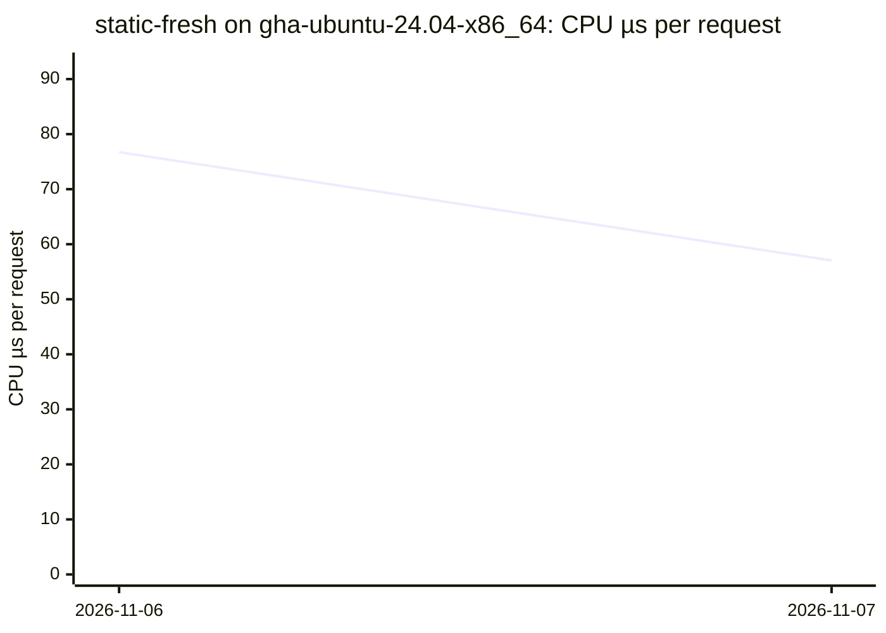
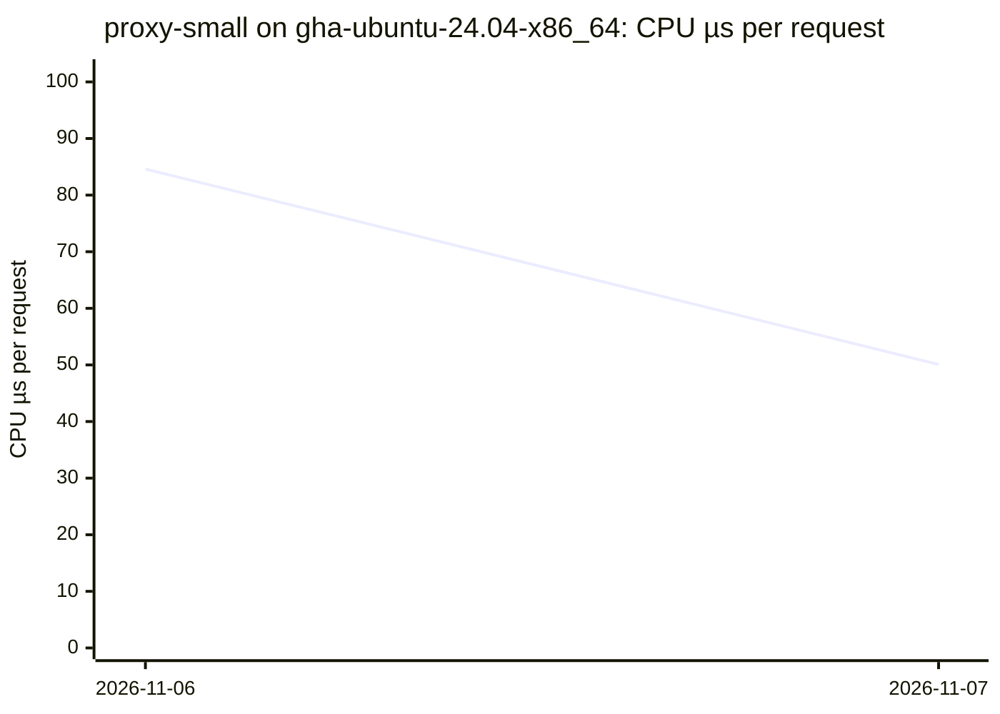
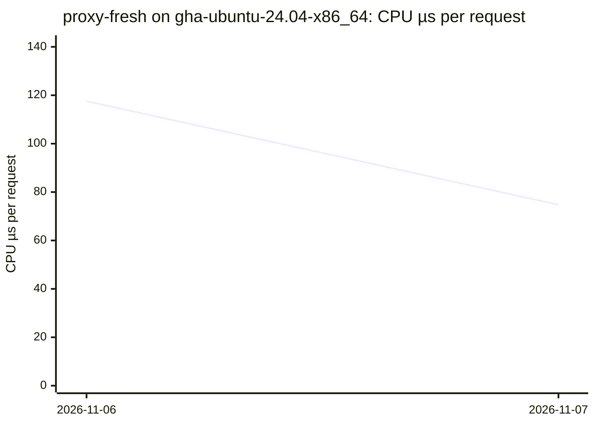
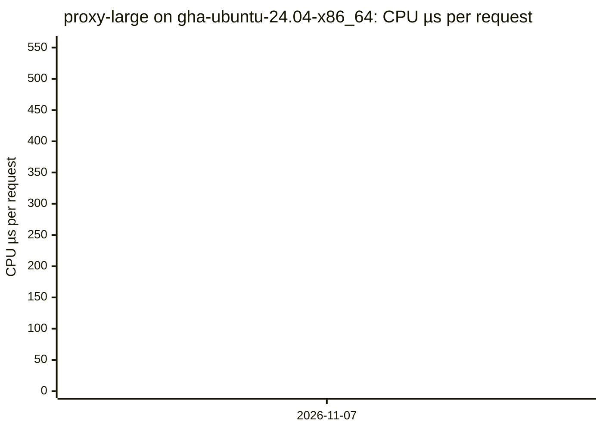
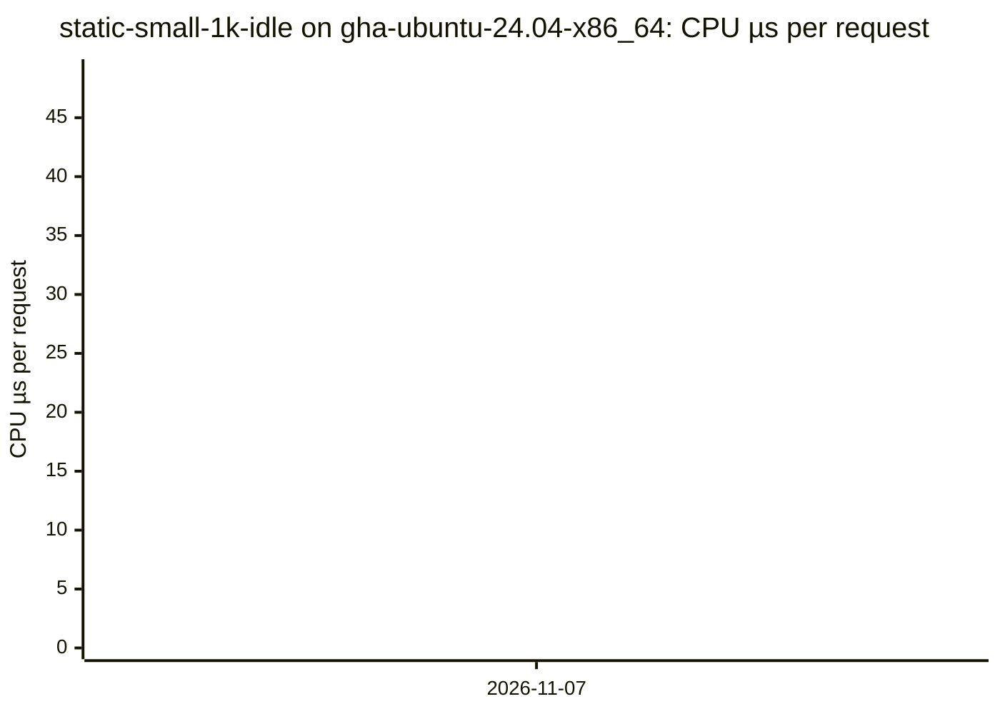
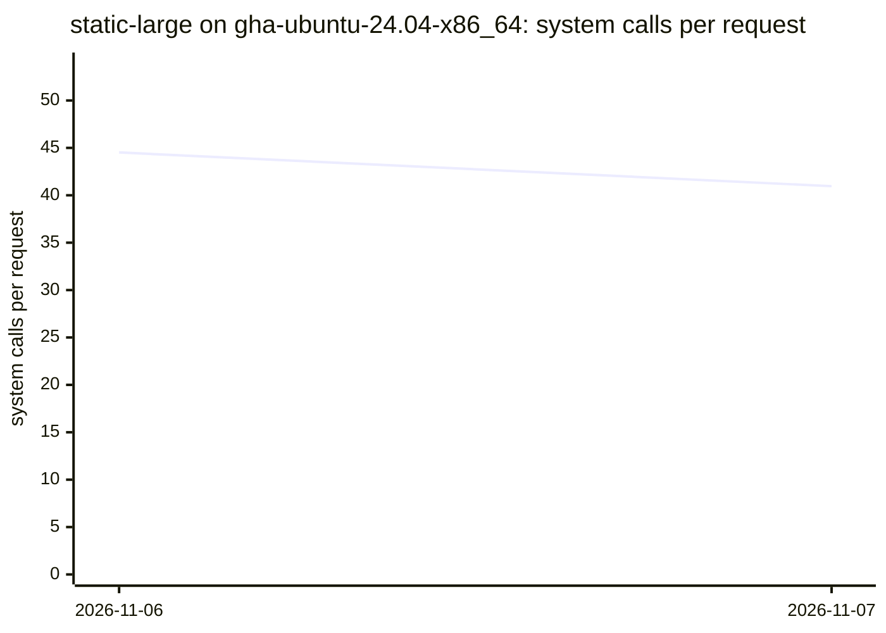
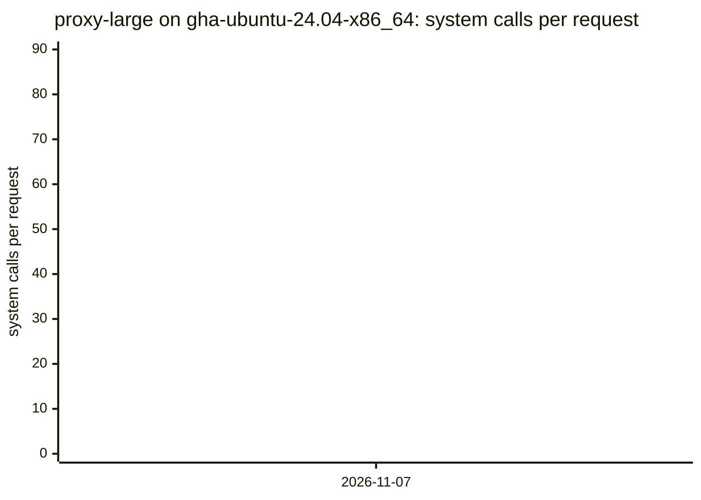
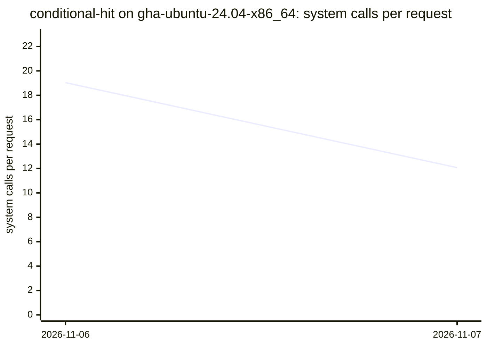
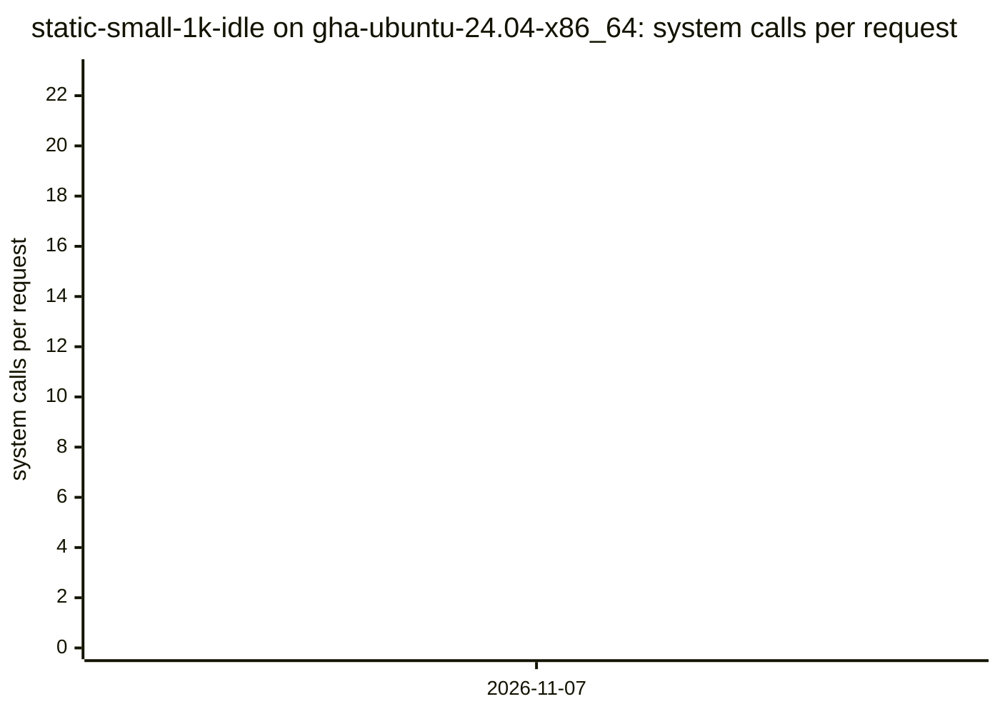

# Benchmarks

CPU time and system calls per request of the `durchlauferhitzer` binary, per scenario, measured nightly on GitHub's runners (NFR-PERF-08; data: [`results.csv`](results.csv), tool: `bench/` on `main`).

Method: CPU time is the server process's own utime+stime (`/proc/<pid>/stat`) over the measured window after a warm-up, divided by the complete, correct responses; system calls come from a separate `strace -c -f` pass, divided by that pass's responses.
Each point is the median of a date's runs on one runner (each runner label is its own series); runs with errors are left out (they stay in the CSV). Runner noise is expected: compare trends, not single points.

## Latest

| Scenario | Runner | Date | Commit | CPU µs/req | Syscalls/req | Req/s | RSS KiB |
|---|---|---|---|---:|---:|---:|---:|
| `static-small` | `gha-ubuntu-24.04-x86_64` | 2026-11-07 | `50fbd16` | 39.16 | 18.44 | 38281 | 3080 |
| `static-large` | `gha-ubuntu-24.04-x86_64` | 2026-11-07 | `50fbd16` | 213.45 | 40.96 | 5800 | 3080 |
| `static-fresh` | `gha-ubuntu-24.04-x86_64` | 2026-11-07 | `50fbd16` | 57.05 | 26.75 | 20832 | 3130 |
| `proxy-small` | `gha-ubuntu-24.04-x86_64` | 2026-11-07 | `50fbd16` | 50.09 | 14.68 | 22260 | 3214 |
| `proxy-fresh` | `gha-ubuntu-24.04-x86_64` | 2026-11-07 | `50fbd16` | 74.78 | 23.00 | 13292 | 3230 |
| `proxy-large` | `gha-ubuntu-24.04-x86_64` | 2026-11-07 | `50fbd16` | 464.25 | 74.97 | 2149 | 20380 |
| `conditional-hit` | `gha-ubuntu-24.04-x86_64` | 2026-11-07 | `50fbd16` | 27.01 | 12.07 | 50715 | 3230 |
| `static-small-1k-idle` | `gha-ubuntu-24.04-x86_64` | 2026-11-07 | `50fbd16` | 40.14 | 18.40 | 37103 | 20362 |

## CPU time per request (µs)

### `static-small` on `gha-ubuntu-24.04-x86_64`

### `static-large` on `gha-ubuntu-24.04-x86_64`

### `static-fresh` on `gha-ubuntu-24.04-x86_64`

### `proxy-small` on `gha-ubuntu-24.04-x86_64`

### `proxy-fresh` on `gha-ubuntu-24.04-x86_64`

### `proxy-large` on `gha-ubuntu-24.04-x86_64`

### `conditional-hit` on `gha-ubuntu-24.04-x86_64`

### `static-small-1k-idle` on `gha-ubuntu-24.04-x86_64`

## System calls per request

### `static-small` on `gha-ubuntu-24.04-x86_64`

### `static-large` on `gha-ubuntu-24.04-x86_64`

### `static-fresh` on `gha-ubuntu-24.04-x86_64`

### `proxy-small` on `gha-ubuntu-24.04-x86_64`

### `proxy-fresh` on `gha-ubuntu-24.04-x86_64`

### `proxy-large` on `gha-ubuntu-24.04-x86_64`

### `conditional-hit` on `gha-ubuntu-24.04-x86_64`

### `static-small-1k-idle` on `gha-ubuntu-24.04-x86_64`

