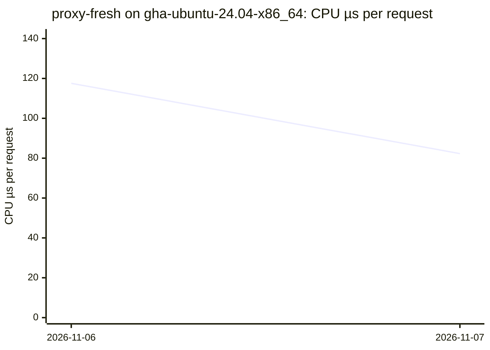
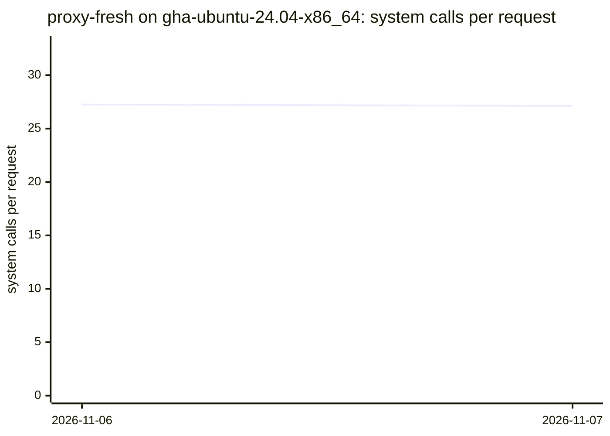
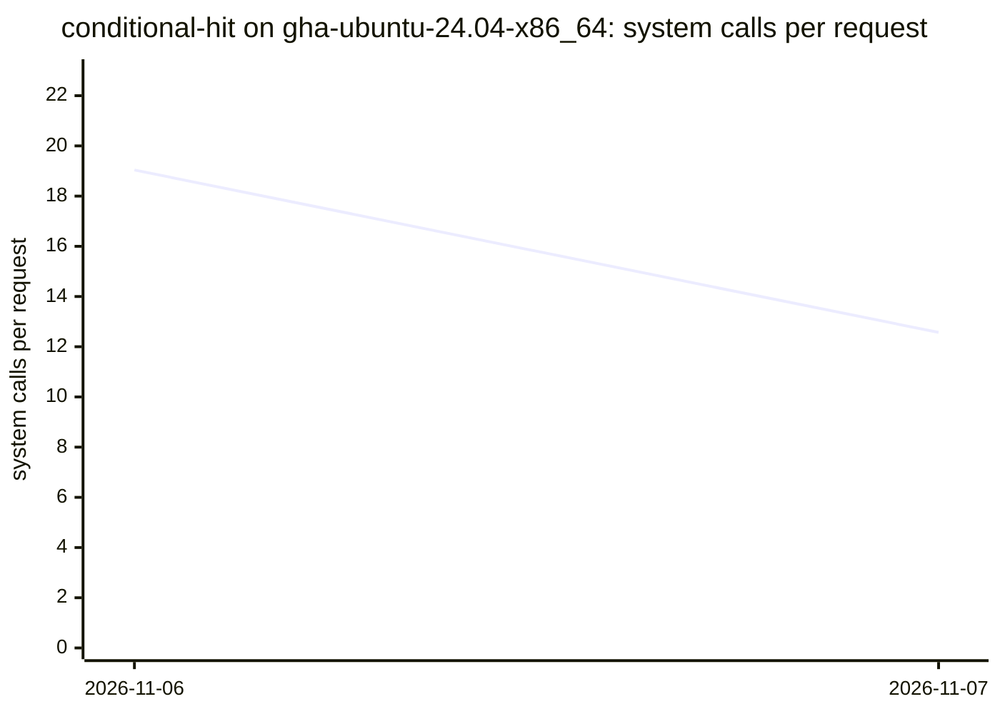
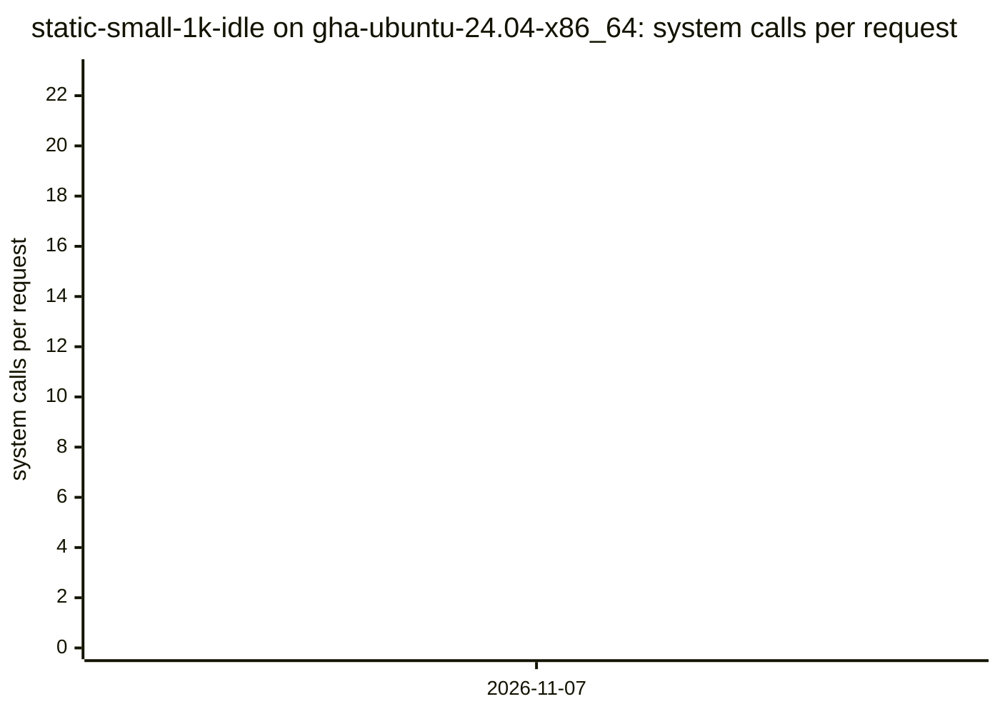

# Benchmarks

CPU time and system calls per request of the `durchlauferhitzer` binary, per scenario, measured nightly on GitHub's runners (NFR-PERF-08; data: [`results.csv`](results.csv), tool: `bench/` on `main`).

Method: CPU time is the server process's own utime+stime (`/proc/<pid>/stat`) over the measured window after a warm-up, divided by the complete, correct responses; system calls come from a separate `strace -c -f` pass, divided by that pass's responses.
Each point is the median of a date's runs on one runner (each runner label is its own series); runs with errors are left out (they stay in the CSV). Runner noise is expected: compare trends, not single points.

## Latest

| Scenario | Runner | Date | Commit | CPU µs/req | Syscalls/req | Req/s | RSS KiB |
|---|---|---|---|---:|---:|---:|---:|
| `static-small` | `gha-ubuntu-24.04-x86_64` | 2026-11-07 | `65d858e` | 39.98 | 18.89 | 35311 | 3108 |
| `static-large` | `gha-ubuntu-24.04-x86_64` | 2026-11-07 | `65d858e` | 187.68 | 44.67 | 6553 | 3108 |
| `static-fresh` | `gha-ubuntu-24.04-x86_64` | 2026-11-07 | `65d858e` | 53.20 | 27.04 | 24323 | 3140 |
| `proxy-small` | `gha-ubuntu-24.04-x86_64` | 2026-11-07 | `65d858e` | 67.40 | 18.88 | 14744 | 3236 |
| `proxy-fresh` | `gha-ubuntu-24.04-x86_64` | 2026-11-07 | `65d858e` | 82.30 | 27.12 | 12032 | 3236 |
| `conditional-hit` | `gha-ubuntu-24.04-x86_64` | 2026-11-07 | `65d858e` | 27.16 | 12.57 | 47539 | 3236 |
| `static-small-1k-idle` | `gha-ubuntu-24.04-x86_64` | 2026-11-07 | `65d858e` | 42.26 | 18.84 | 33080 | 20360 |

## CPU time per request (µs)

### `static-small` on `gha-ubuntu-24.04-x86_64`

### `static-large` on `gha-ubuntu-24.04-x86_64`

### `static-fresh` on `gha-ubuntu-24.04-x86_64`

### `proxy-small` on `gha-ubuntu-24.04-x86_64`

### `proxy-fresh` on `gha-ubuntu-24.04-x86_64`

### `conditional-hit` on `gha-ubuntu-24.04-x86_64`

### `static-small-1k-idle` on `gha-ubuntu-24.04-x86_64`

## System calls per request

### `static-small` on `gha-ubuntu-24.04-x86_64`

### `static-large` on `gha-ubuntu-24.04-x86_64`

### `static-fresh` on `gha-ubuntu-24.04-x86_64`

### `proxy-small` on `gha-ubuntu-24.04-x86_64`

### `proxy-fresh` on `gha-ubuntu-24.04-x86_64`

### `conditional-hit` on `gha-ubuntu-24.04-x86_64`

### `static-small-1k-idle` on `gha-ubuntu-24.04-x86_64`

