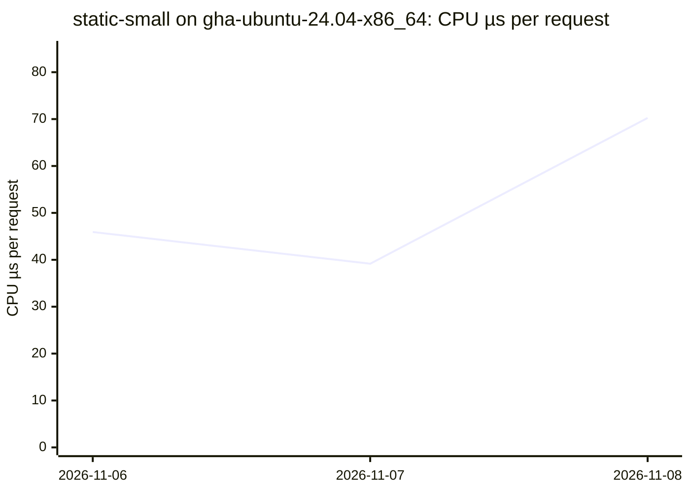
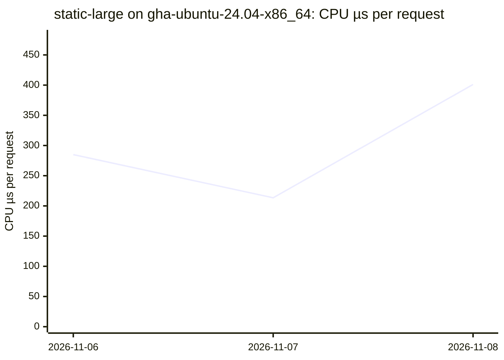
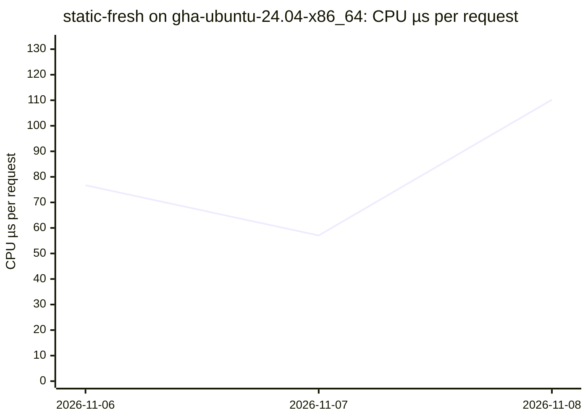
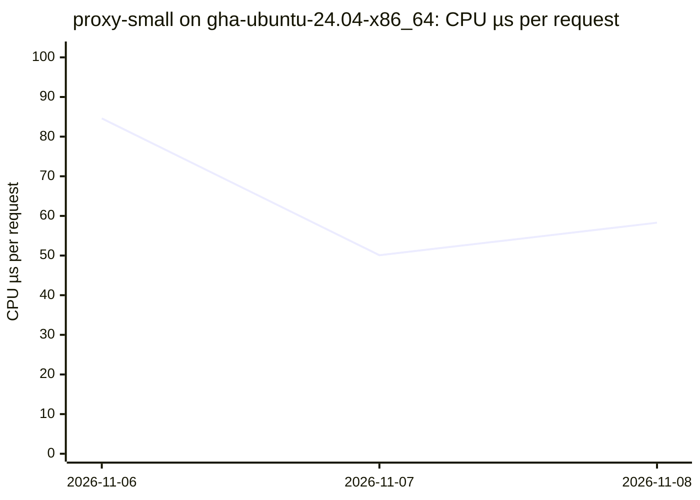
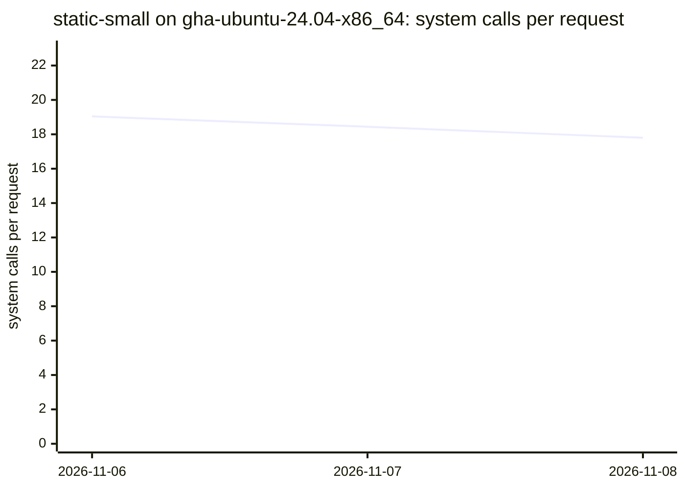
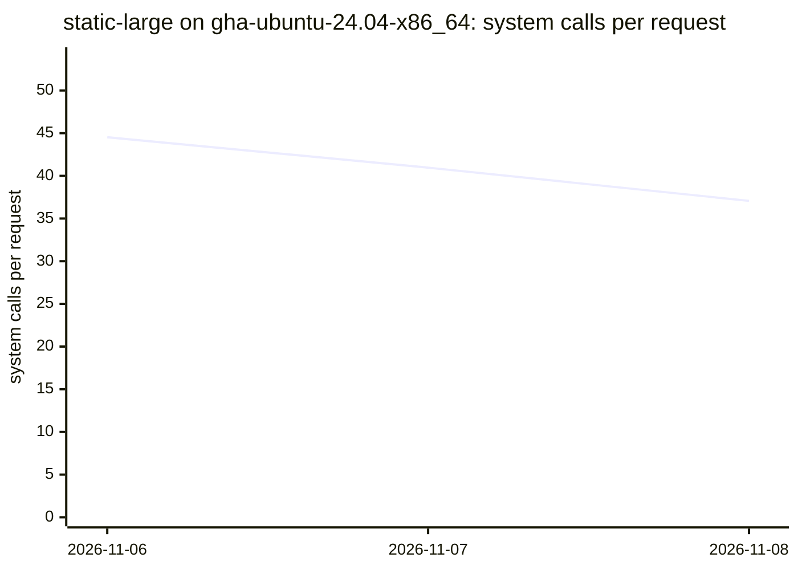
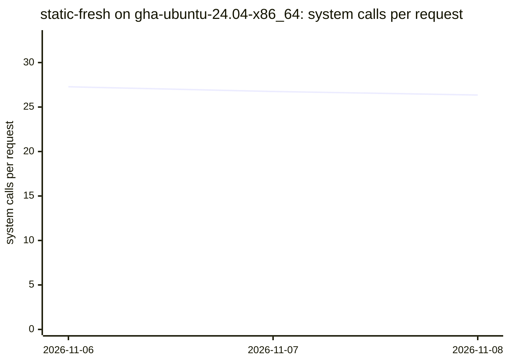
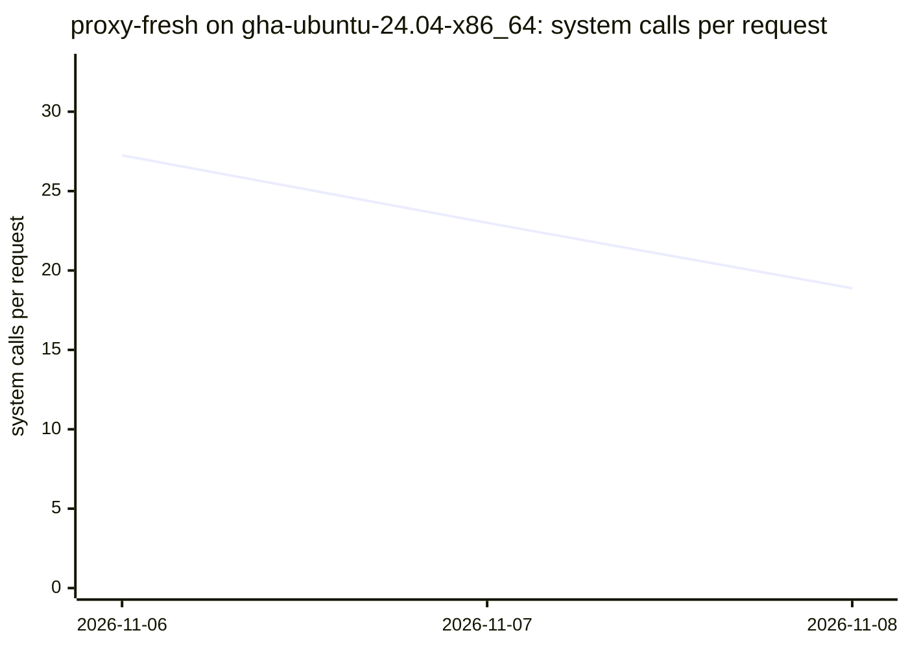
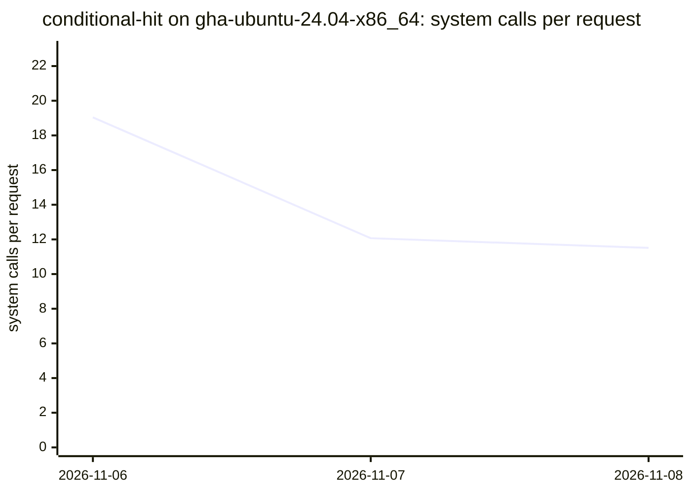
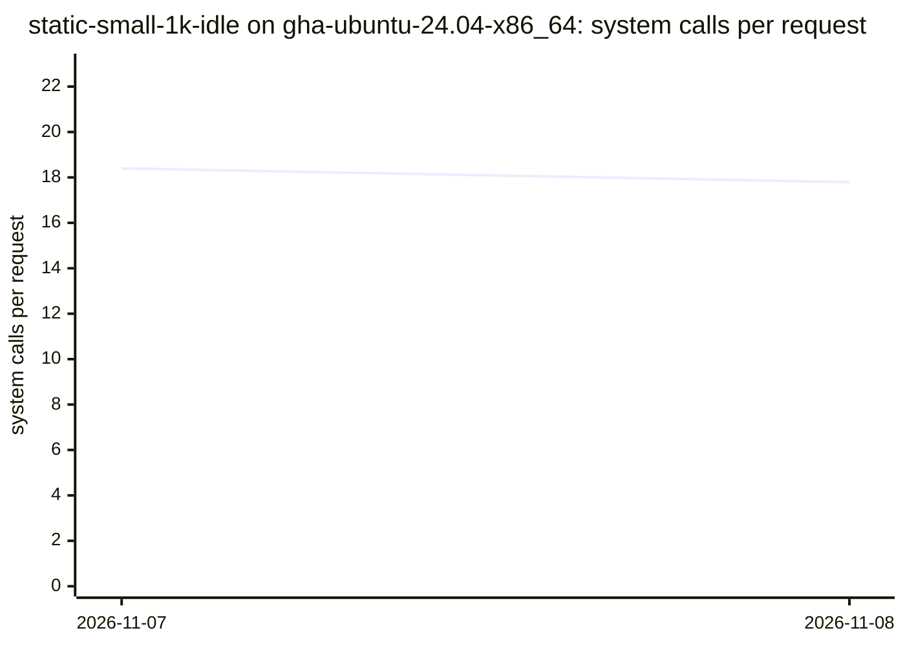

# Benchmarks

CPU time and system calls per request of the `durchlauferhitzer` binary, per scenario, measured nightly on GitHub's runners (NFR-PERF-08; data: [`results.csv`](results.csv), tool: `bench/` on `main`).

Method: CPU time is the server process's own utime+stime (`/proc/<pid>/stat`) over the measured window after a warm-up, divided by the complete, correct responses; system calls come from a separate `strace -c -f` pass, divided by that pass's responses.
Each point is the median of a date's runs on one runner (each runner label is its own series); runs with errors are left out (they stay in the CSV). Runner noise is expected: compare trends, not single points.

## Latest

| Scenario | Runner | Date | Commit | CPU µs/req | Syscalls/req | Req/s | RSS KiB |
|---|---|---|---|---:|---:|---:|---:|
| `static-small` | `gha-ubuntu-24.04-x86_64` | 2026-11-08 | `8f68af3` | 70.24 | 17.80 | 21458 | 2984 |
| `static-large` | `gha-ubuntu-24.04-x86_64` | 2026-11-08 | `8f68af3` | 401.07 | 37.07 | 3036 | 2984 |
| `static-fresh` | `gha-ubuntu-24.04-x86_64` | 2026-11-08 | `8f68af3` | 110.20 | 26.35 | 11520 | 3052 |
| `proxy-small` | `gha-ubuntu-24.04-x86_64` | 2026-11-08 | `8f68af3` | 58.29 | 10.25 | 17137 | 3148 |
| `proxy-fresh` | `gha-ubuntu-24.04-x86_64` | 2026-11-08 | `8f68af3` | 114.80 | 18.88 | 8643 | 3148 |
| `proxy-large` | `gha-ubuntu-24.04-x86_64` | 2026-11-08 | `8f68af3` | 836.13 | 74.98 | 1193 | 20284 |
| `conditional-hit` | `gha-ubuntu-24.04-x86_64` | 2026-11-08 | `8f68af3` | 49.38 | 11.51 | 28388 | 3148 |
| `static-small-1k-idle` | `gha-ubuntu-24.04-x86_64` | 2026-11-08 | `8f68af3` | 71.65 | 17.79 | 20788 | 20276 |

## CPU time per request (µs)

### `static-small` on `gha-ubuntu-24.04-x86_64`

### `static-large` on `gha-ubuntu-24.04-x86_64`

### `static-fresh` on `gha-ubuntu-24.04-x86_64`

### `proxy-small` on `gha-ubuntu-24.04-x86_64`

### `proxy-fresh` on `gha-ubuntu-24.04-x86_64`

### `proxy-large` on `gha-ubuntu-24.04-x86_64`

### `conditional-hit` on `gha-ubuntu-24.04-x86_64`

### `static-small-1k-idle` on `gha-ubuntu-24.04-x86_64`

## System calls per request

### `static-small` on `gha-ubuntu-24.04-x86_64`

### `static-large` on `gha-ubuntu-24.04-x86_64`

### `static-fresh` on `gha-ubuntu-24.04-x86_64`

### `proxy-small` on `gha-ubuntu-24.04-x86_64`

### `proxy-fresh` on `gha-ubuntu-24.04-x86_64`

### `proxy-large` on `gha-ubuntu-24.04-x86_64`

### `conditional-hit` on `gha-ubuntu-24.04-x86_64`

### `static-small-1k-idle` on `gha-ubuntu-24.04-x86_64`

