# Benchmarks

CPU time and system calls per request of the `durchlauferhitzer` binary, per scenario, measured nightly on GitHub's runners (NFR-PERF-08; data: [`results.csv`](results.csv), tool: `bench/` on `main`).

Method: CPU time is the server process's own utime+stime (`/proc/<pid>/stat`) over the measured window after a warm-up, divided by the complete, correct responses; system calls come from a separate `strace -c -f` pass, divided by that pass's responses.
Each point is the median of a date's runs on one runner (each runner label is its own series); runs with errors are left out (they stay in the CSV). Runner noise is expected: compare trends, not single points.

## Latest

| Scenario | Runner | Date | Commit | CPU µs/req | Syscalls/req | Req/s | RSS KiB |
|---|---|---|---|---:|---:|---:|---:|
| `static-small` | `gha-ubuntu-24.04-x86_64` | 2026-11-10 | `4cf9be9` | 49.03 | 17.79 | 31823 | 3116 |
| `static-large` | `gha-ubuntu-24.04-x86_64` | 2026-11-10 | `4cf9be9` | 279.07 | 37.22 | 4443 | 3124 |
| `static-fresh` | `gha-ubuntu-24.04-x86_64` | 2026-11-10 | `4cf9be9` | 79.20 | 26.40 | 16304 | 3164 |
| `proxy-small` | `gha-ubuntu-24.04-x86_64` | 2026-11-10 | `4cf9be9` | 43.27 | 10.25 | 23109 | 3244 |
| `proxy-fresh` | `gha-ubuntu-24.04-x86_64` | 2026-11-10 | `4cf9be9` | 85.35 | 18.88 | 11657 | 3244 |
| `proxy-large` | `gha-ubuntu-24.04-x86_64` | 2026-11-10 | `4cf9be9` | 682.24 | 74.97 | 1464 | 20584 |
| `proxy-file` | `gha-ubuntu-24.04-x86_64` | 2026-11-10 | `4cf9be9` | 70.43 | 22.00 | 19052 | 3512 |
| `conditional-hit` | `gha-ubuntu-24.04-x86_64` | 2026-11-10 | `4cf9be9` | 34.25 | 11.53 | 41591 | 3244 |
| `static-small-1k-idle` | `gha-ubuntu-24.04-x86_64` | 2026-11-10 | `4cf9be9` | 49.90 | 17.80 | 30915 | 20576 |

## CPU time per request (µs)

### `static-small` on `gha-ubuntu-24.04-x86_64`

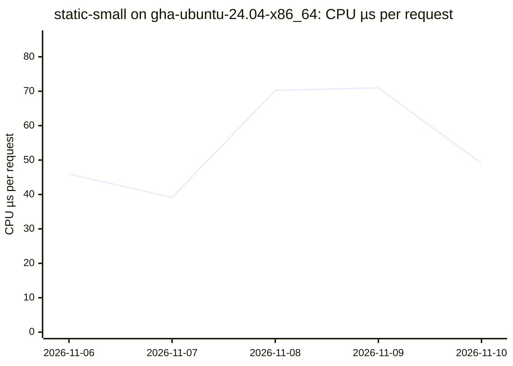

### `static-large` on `gha-ubuntu-24.04-x86_64`

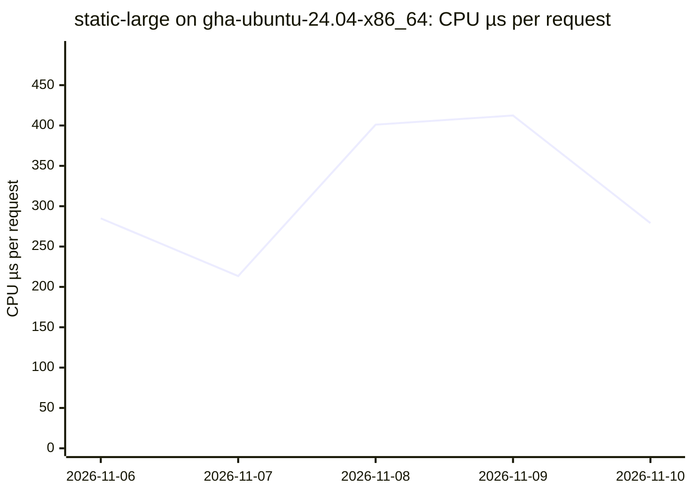

### `static-fresh` on `gha-ubuntu-24.04-x86_64`

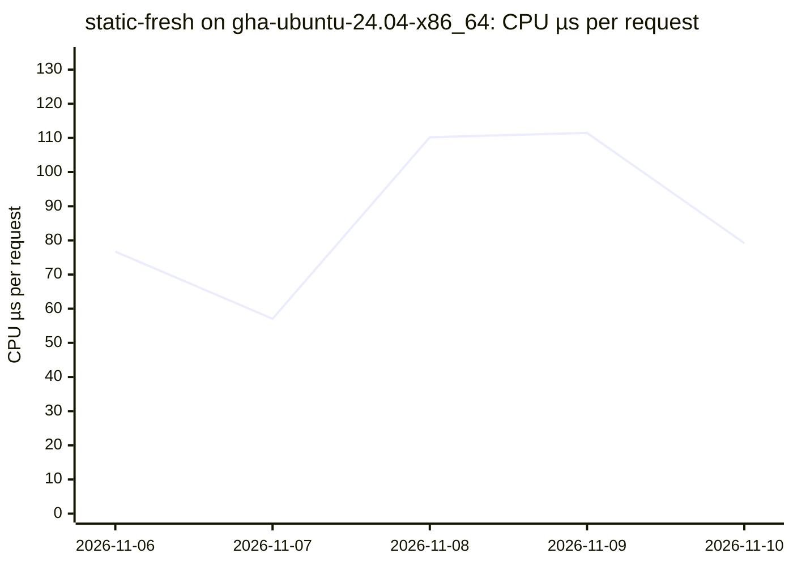

### `proxy-small` on `gha-ubuntu-24.04-x86_64`

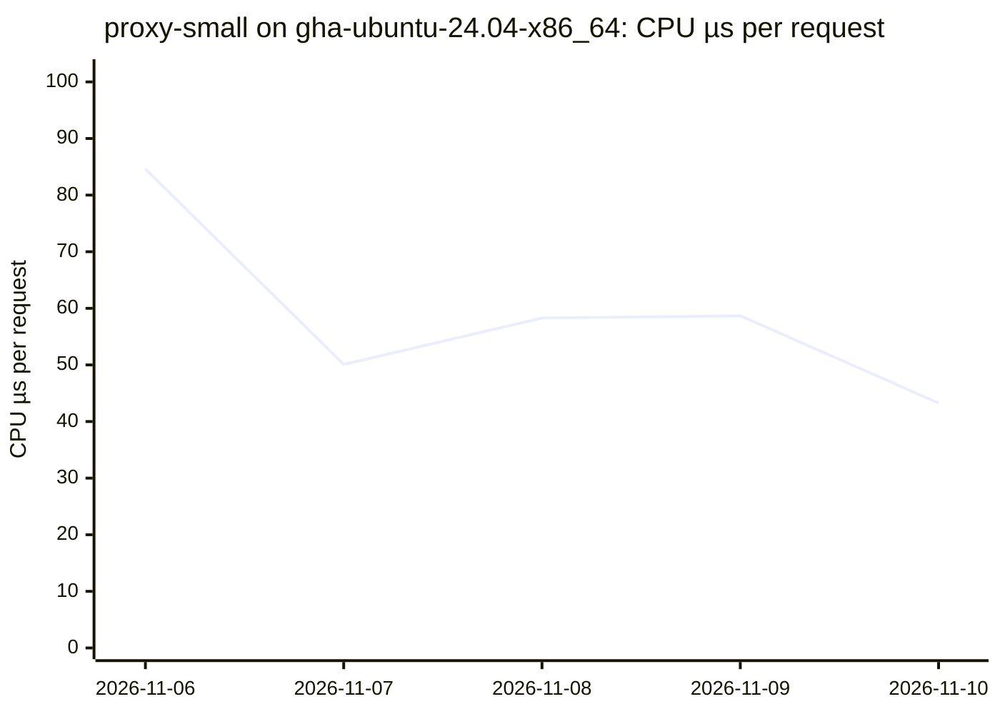

### `proxy-fresh` on `gha-ubuntu-24.04-x86_64`

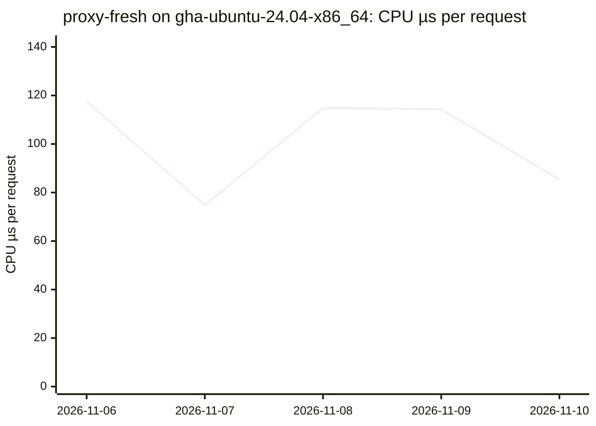

### `proxy-large` on `gha-ubuntu-24.04-x86_64`

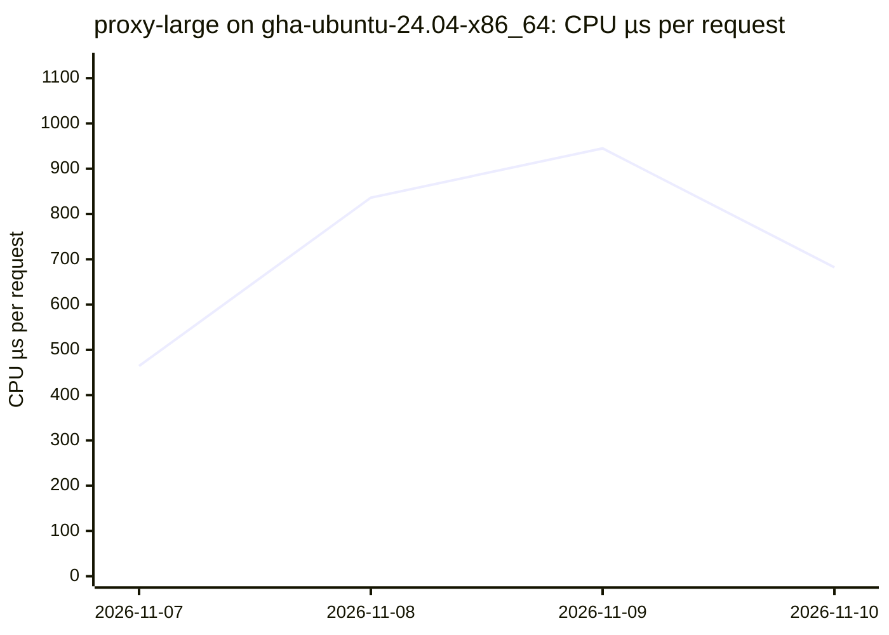

### `proxy-file` on `gha-ubuntu-24.04-x86_64`

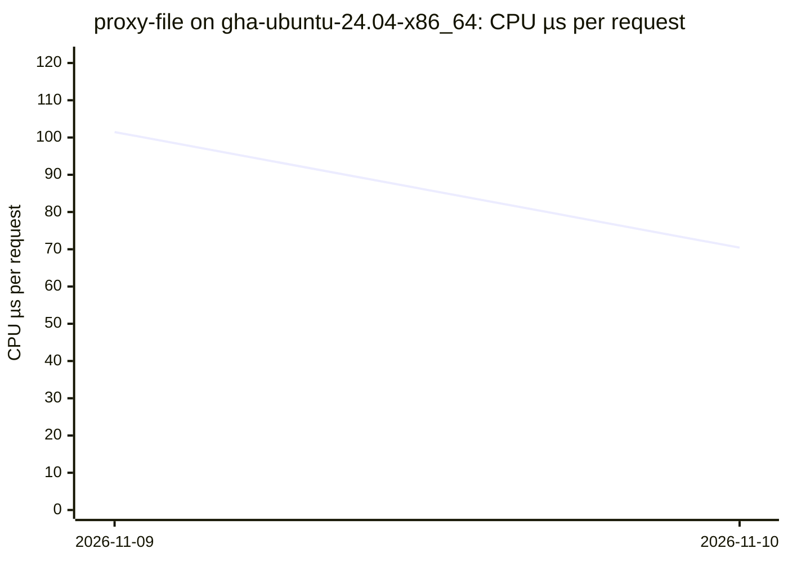

### `conditional-hit` on `gha-ubuntu-24.04-x86_64`

### `static-small-1k-idle` on `gha-ubuntu-24.04-x86_64`

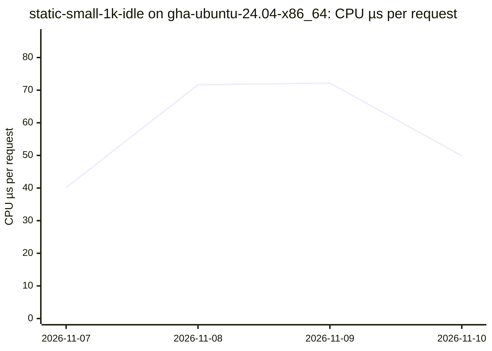

## System calls per request

### `static-small` on `gha-ubuntu-24.04-x86_64`

### `static-large` on `gha-ubuntu-24.04-x86_64`

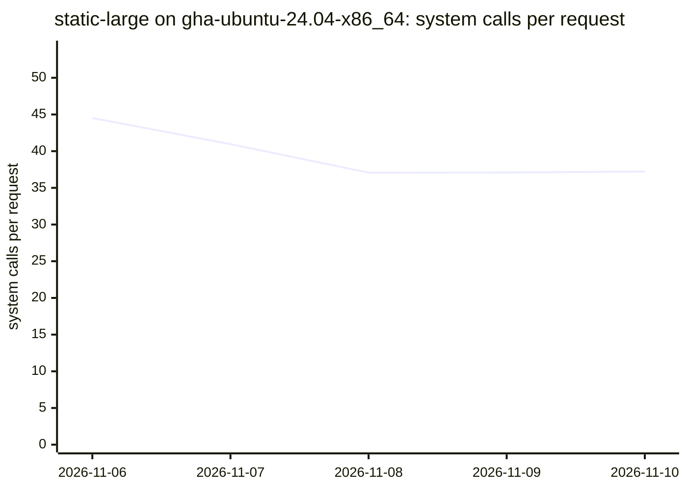

### `static-fresh` on `gha-ubuntu-24.04-x86_64`

### `proxy-small` on `gha-ubuntu-24.04-x86_64`

### `proxy-fresh` on `gha-ubuntu-24.04-x86_64`

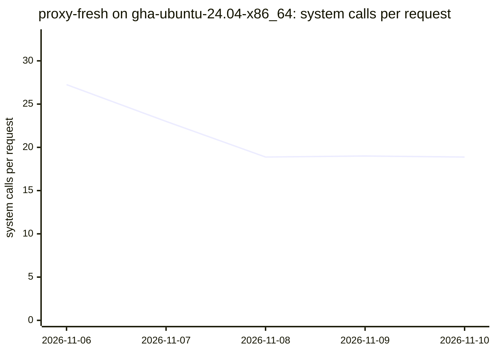

### `proxy-large` on `gha-ubuntu-24.04-x86_64`

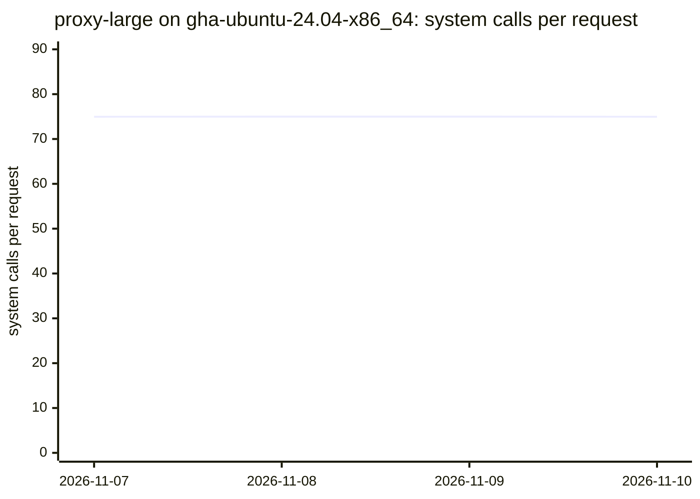

### `proxy-file` on `gha-ubuntu-24.04-x86_64`

### `conditional-hit` on `gha-ubuntu-24.04-x86_64`

### `static-small-1k-idle` on `gha-ubuntu-24.04-x86_64`

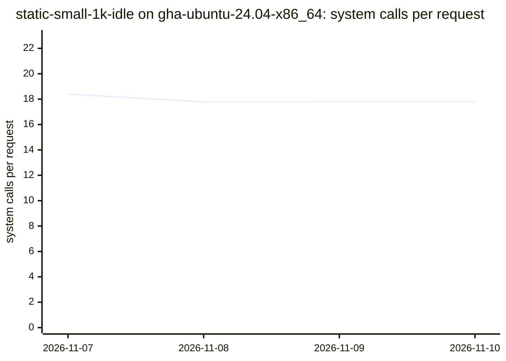
